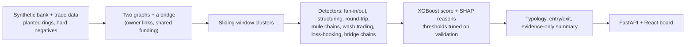

# TwinTrace

**A live radar for dirty money. It watches bank transfers and stock trades together, and catches the rings that no single rule can see.**
Build Beyond'26 · PS 2.1

Criminals split money into tiny pieces and pass it through many accounts, then wash it again through the stock market. Banks check
transactions one at a time, so each piece looks innocent. TwinTrace connects the **bank layer** and the **trade layer** into one graph, finds
the rings, names the crime, and shows an investigator exactly how the money moved.

> Everything here is synthetic (generated data, planted rings). Alerts are leads for human review, not proof of wrongdoing. No real people or firms.

## Run it

```bash
python -m venv .venv && .venv/Scripts/activate      # macOS/Linux: source .venv/bin/activate
make setup      # pip install -r requirements.txt
make run        # generate data + detect + train + evaluate (about a minute, once)
make demo       # opens the investigation board at http://127.0.0.1:8000
```

No `make` on Windows? Use `python -m src.cli <setup|data|run|test|web|demo>`. The precomputed `data/processed/`, `artifacts/` and the built
front end `web/dist/` are included, so `make demo` works immediately and fully offline. To change the UI: `make web-build` (needs Node 18+).

## The board (what you show the judges)

One screen, everything clickable:

| | |
|---|---|
| **Investigation board** | Every account is a dot (circles = bank, diamonds = trading accounts). Flagged rings glow, coloured by crime type. Zoom, drag, hover. |
| **90-day replay** | Press play (or Space). Money moves across the network and each ring **fires an alert with a ripple** the moment its pattern completes. Scrub the timeline, which is split into *tune / validation / test* so judges can see which period the model never trained on. |
| **Case file** | Click an alert: risk gauge, a plain-English summary where every number comes from the alert's own evidence, entry/exit accounts, an interactive money trail you can **replay hop by hop**, a timeline chart, and the SHAP reasons it was flagged. |
| **Click-to-trace** | Click *any* account: follow the money upstream and downstream, **across from the bank into the trading layer** through the account owner. Keep clicking nodes to keep walking the trail. |
| **Plant a ring, live** | Pick a laundering pattern and how hard it hides (stealth). A brand-new ring is generated into the live data and run through the same detectors and trained model. Verdict card: **TwinTrace vs the rule baseline**. It is sometimes missed, and the app says so and lets you lower the bar to catch it. |
| **What-if lab** | Drag the alert thresholds. Precision, recall, false-alarm rate and the benchmark vs the baselines update live, and the board re-filters as you drag. |
| **Reveal truth** | Because the data is synthetic we know the answer: green = real ring, red dashed = false alarm, amber = a ring we missed. Nothing hidden. |
| **Guided demo** | A button that walks through all of the above with captions, so you never have to remember the order. |

### A 3-minute demo script

1. **Guided demo, steps 1-2** (30 s): "Every dot is an account. Watch 90 days play: when a pattern completes, an alert fires."
2. **Open a case file** (45 s): click a mule-chain alert. "Risk 99. This summary is built only from the alert's own numbers. Replay the trail hop by hop."
3. **Trace the money** (30 s): "Click any account and follow it upstream and downstream, even from the bank into the stock market."
4. **Plant a ring** (45 s): plant *Wash / circular trading*. "A new ring, live. TwinTrace caught it. The old rule system flagged 0 of 3 accounts."
5. **What-if lab** (20 s): "Lower the bar: catch more, pay with more false alarms. That is the whole tradeoff."
6. **Reveal truth** (10 s): "We know the ground truth, so you can see our misses too."

## How it works (short version)



* **Layer 1 (bank)**: fan-out, fan-in with structuring (just under INR 50,000), time-ordered round-trips, mule/pass-through chains. A *regularity* signal
  (was this pair already trading before the window?) stops payroll, rent, shop settlements and family transfers from flooding the queue.
* **Layer 2 (trades)**: wash trading (net position vs gross volume, internal volume share, liquidity-adjusted) and loss-booking (repeated same-day reversals at off-market prices).
* **Bridge**: account owners link bank and trading accounts; shared funding sources; bank → trading account → trade → withdrawal chains.
* **Explainable**: typology label, entry/exit points, top-3 SHAP drivers, and summaries whose numbers are checked by a test against the alert evidence.

Code map: `src/data_gen` (generators), `src/graph` + `src/detectors` (graphs, clusters, detectors), `src/scoring`, `src/explain`, `src/eval`, `src/pipeline.py`
(training/eval), `src/web` + `src/server.py` (API: board, trace, what-if, plant ring), `web/` (React + canvas force-graph front end), `tests/` (89 tests).

## Results (held-out test period, seed 42, 45 planted rings)

| Method | Precision | Recall | F1 | False-positive rate | Alerts / 1,000 accounts |
|---|---:|---:|---:|---:|---:|
| Rule baseline | 0.095 | 0.711 | 0.167 | 0.0738 | 82.5 |
| Single-layer graph (bank only) | 0.938 | 0.644 | 0.764 | 0.0008 | 1.6 |
| Two layers, no bridge | 0.950 | 0.844 | 0.894 | 0.0001 | 2.0 |
| **TwinTrace** (two layers + bridge) | 0.952 | 0.822 | 0.883 | 0.0013 | 2.1 |

Full tables: [artifacts/results.md](artifacts/results.md). Averaged over four fresh seeds: TwinTrace F1 0.89, two layers without the bridge 0.92,
bank-only 0.76, rule baseline 0.15 ([artifacts/seed_sweep.md](artifacts/seed_sweep.md)).

**The honest reading:** graph methods beat the rule baseline by a wide margin (about 57× fewer false alarms), and adding the trade layer is a big win
because wash trading and loss-booking are invisible to the bank layer. The *bridge* did not add detection accuracy over simply running both layers
side by side (slightly worse recall on every fresh seed). What it adds is cross-layer alerts ("layering through the market"), the funding source and
cash-out account as entry/exit points, and an explanation of *why* a trading group is suspicious.

## Limitations

* **Synthetic data.** The shipped results use an IBM-format synthetic background; the real IBM AML files could not be downloaded here (drop `HI-Small_Trans.csv`
  into `data/raw/`, see [data/raw/README.md](data/raw/README.md); the loader is unit-tested on a file in the real format but was never run on the real 5M-row file).
* **I wrote both the generator and the detectors**, so recall is optimistic versus real data, and "legitimate trading groups" look like wash rings by construction.
* **Small test set** (45 rings, 4-8 per typology): treat differences of a few points as noise.
* **Some features look slightly ahead in time** (7 days of context around a window, up to 14 days of trades after a cluster): retrospective-investigation features, not strictly real-time.
* **Live planting** reuses the real generators and the saved model; it can miss, which is the point. Planted rings stay in memory until you press *Remove all planted rings* or restart.
* The board shows alerts scoring 50 or more (all default alerts plus near-misses for the what-if slider); lower-scoring candidates are in `artifacts/alerts_all.json`.
* Not implemented (stretch goals): pump-and-dump and front-running.
* Prices are a seeded random walk by default; `data.use_yfinance: true` borrows real price *shapes* when online.

## Related work

Graph-based AML on transfer networks is well studied (e.g. Weber et al. 2019 on Bitcoin; IBM's synthetic AML benchmark, Altman et al., NeurIPS 2023). Graph-based
wash-trading detection exists mostly for crypto/NFT markets, and there is research on graph-based stock surveillance. Most systems are single-layer and use black-box models.
We claim only: the **link between the money layer and the trade layer**, and **transparent detectors with evidence-only explanations**.
